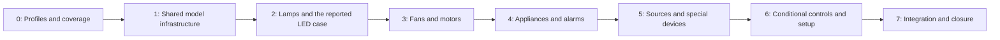

# Phase 1.12 — Missing component calculation

Status: **1.12.0–7 complete locally within declared functional scope, 2026-10-15**. The user authorized
all milestones in one continuous workflow. All 30 missing behaviours now have
versioned teaching profiles; the existing three-phase motor has an explicit setup
action. Shared numerical, persistence and Inspector integration is implemented;
functional/static/runtime/source and built acceptance is recorded through combined
full-attempt and focused recovery evidence. Historical performance exceptions
remain open; the strict repository-wide gate is not green. See the
[current implementation record](../audits/phase-1-missing-component-calculation.md).
The user requested this new phase after the repository checkpoint was committed and pushed.
The implementation baseline is GitHub `main` at
`ac6c1d9cc889506d04c2a89f372c9db1c241dfe8`.

## Goal

Make the ordinary catalogue components calculate and display their declared
electrical behaviour. A placed component's artwork, voltage and wattage labels
must correspond to an implemented model or an explicit configuration requirement.
Warnings and badges alone do not implement a calculation.

The first visible deliverable is the reported **L/N terminals → 230 V, 9 W LED**
workflow: a 12 V supply produces a clear operating-voltage finding and the lamp's
declared off state; a valid 230 V supply produces calculated terminal voltage,
current and power with the matching lamp appearance.

## Baseline and scope

The [catalogue audit](../audits/catalogue-simulation-gaps.md) reviewed all **116**
placement defaults. The original **31** unassessed defaults comprised **30** needing
missing electrical behaviour code; the three-phase motor already has a supported
teaching model after explicit settings are configured. The other **85** are not a
claim of complete appliance simulation: several controls have conditional or
partial behaviour, and rating, timing, damage and standards coverage differ.

The current feedback repair is already implemented and published. It supplies
visible unavailable-result messages, separate Model unavailable / Ratings unknown
badges, nominal design-voltage mismatch warnings and current-result guards. Its
465 affected unit passes, 842 runtime parity cases and focused browser evidence
are the baseline, not acceptance of this new phase.

### Default gaps assigned to this phase

| Family | Count | Component types | Destination |
| --- | --- | --- | --- |
| Electronic lamps | 5 | `bulb`, `bulb-cfl`, `bulb-smart-rgb`, `led-downlight`, `tube-light` | 1.12.2 |
| Single-phase fans, motors and pumps | 6 | `ceiling-fan`, `extractor-fan`, `industrial-exhaust-fan`, `table-fan`, `motor`, `water-pump` | 1.12.3 |
| Appliances | 9 | `air-conditioner`, `induction-hob`, `ev-charger`, `extractor-hood`, `heat-pump`, `dishwasher`, `washing-machine`, `tumble-dryer`, `fridge-freezer` | 1.12.4 |
| Sounders and alarm electronics | 6 | `bell`, `electric-buzzer`, `wireless-doorbell`, `alarm-siren`, `smoke-alarm`, `burglar-alarm` | 1.12.4 |
| Sources and special devices | 4 | `solar-pv-panel`, `step-up-down-transformer`, `spd`, `temperature-sensor` | 1.12.5 |
| Existing model needing configuration | 1 | `motor-3phase` | 1.12.6 |
| **Total default unassessed entries** | **31** | Full identity/label inventory is in the audit | |

Also review existing sensor automation, timer, coil, protection and dimming
defaults. These are additional conditional behaviours within the 85 other
entries; they must have usable declared settings or a precise, actionable reason
why the requested behaviour is unavailable. Do not count a conducting contact as
proof that its coil, timer or protective mechanism works.

## Model and data rules

1. **Declare the electrical law.** Electronic loads, motor loads and composite
   appliances must have appropriate branch laws and operating states. A wattage
   label cannot be converted indiscriminately into a fixed resistor.
2. **Declare the parameters.** Each profile records nominal supply, operating
   band, consumption/law, required state inputs, provenance, version and limits.
   Review primary manufacturer/documentation sources during implementation where
   applicable. Generic profiles must be labeled teaching assumptions and editable.
3. **Keep quantities separate.** Nominal/design voltage, maximum rating, solved
   terminal voltage, current, real/apparent power, mechanical output, protective
   operation and damage are separate. Do not invent a universal power factor,
   motor speed, destruction threshold or trip from an unrelated rating.
4. **Make ordinary placement usable.** New placements receive the accepted
   versioned profile or a required setup flow. Nameplate editing must update its
   model coherently. Preserve existing drawing IDs, terminals, wire routes, custom
   ratings, independent supplies and persistent faults/damage during migration.
5. **Use one runtime.** Direct domain, Comlink and local Hono/Worker consume the
   same model and accepted result. Rendering, Fault Lab and Matter consume those
   results; presentation cannot supply missing electrical behaviour.
6. **Version changes honestly.** Update model/profile versions when semantics
   change. Define file import/default migration and invalidate obsolete captures
   and derived evidence. Preserve stored drawings and historical records.
7. **Bound the teaching scope.** Electrical operating behaviour is required for
   the accepted profiles. Unimplemented mechanical, thermal, chemical, protocol,
   transient and certification behaviour remains explicitly bounded. An exception
   to the listed calculation scope requires a user decision; it is not automatic
   phase completion.

## Milestones

**1.12.0–7 are complete locally within the declared teaching-model scope.**
The native 12 V/230 V LED workflow and every new family pass actual source/built
workflows. The audit retains 2,197 units, 897 exact runtime cases, 34 local API
groups, 207 unique source cases and 22 unique built cases plus two intentional
built parity skips. Original failed attempts and focused recovery remain explicit.
Performance measurements do not close the historical 8 ms / dense 60 fps limits.

| Milestone | Deliverable | Acceptance needed to advance |
| --- | --- | --- |
| **1.12.0 — Profile and coverage specification** | Record a reproducible 116-entry inventory, identify conditional models, define per-family laws/defaults/limits, reference data and migration. Record numerical-method and parameter decisions in an ADR. Prepare the lamp profile and configuration controls for review. These artifacts are now prepared locally; publication is separate. | Every default gap has an owner, model family, explicit parameter source/assumption, example circuit and acceptance case. Missing input data is identified. Model decisions are concrete before implementation. Specification/reference evidence does not accept integrated models. |
| **1.12.1 — Shared model infrastructure** | Add typed, validated profiles/state, branch compilation, operating-point derivation, file persistence/default handling and numerical support for the selected electronic/motor laws. Implement convergence/state selection limits and readable failure results. | Independent expected-value fixtures, conservation and convergence checks; invalid profile rejection; import/export/Undo preservation; existing fixed-resistance/source/transformer/control behaviour remains correct. |
| **1.12.2 — Common lamps first** | Implement the five electronic lamp types with accepted operating bands and power laws. Bind on/off/brightness and readings to the solved state. Validate electronic-lamp/dimmer compatibility explicitly. | The native 12 V versus 230 V LED workflow passes through all runtimes and built/source desktop/phone. Test low/valid/high voltage, off/open state, reversed supply where applicable, series/parallel loads and failure to converge. Every lamp type has numerical and rendered evidence. |
| **1.12.3 — Fans and single-phase motors** | Implement the six motor/fan/pump entries using the accepted electrical equivalent and explicitly declared running/startup/control assumptions. Keep input power separate from shaft output and visual speed. | Independent voltage/current/power and operating-band cases; switching, speed setting where supported, open return and multiple loads; no unmodeled mechanical or startup claim. |
| **1.12.4 — Appliances, sounders and alarms** | Implement the 15 entries with declared consuming branches and selected operating modes, including standby/off/alarm/cycle states where appropriate. Define state inputs rather than inventing sensor or communication events. | Each entry has an ordinary usable profile, isolated expected-value cases and an actual browser workflow. Composite/mode changes conserve power and invalidate stale results; protection responds to calculated current under its own declared model. |
| **1.12.5 — Sources and special devices** | Add a declared PV V–I profile, a shared-winding autotransformer model, bounded SPD electrical behaviour and a temperature-to-electrical NTC model. Declare required environmental/state inputs. | PV input/output consistency; autotransformer ratio/power/shared reference without false isolation; bounded SPD normal/clamp behaviour; NTC resistance from explicit temperature/profile. Unsupported transients/environmental effects remain clearly identified. |
| **1.12.6 — Conditional controls and ordinary setup** | Make the existing three-phase motor, coils, timers, protection and sensor controls discoverable and usable with accepted profile defaults or explicit setup. Complete remaining declared control behaviour needed for ordinary catalogue use. | Actual placement/configuration/Run flows; independent contact/coil/source ratings, correct timer/protection events, phase/sequence cases, reset/clear/replacement and persisted state. The consolidated matrix distinguishes conducting contacts from functioning controls. |
| **1.12.7 — Complete integration and closure** | Refresh the entire catalogue matrix, default/example circuits, faults, tools, guides and published component claims. Produce a resumable phase gate and acceptance audit. | Every listed default gap is implemented and verified or explicitly deferred by the user. Current functional/static/runtime/browser gates pass; remaining physics limits and historical performance exceptions are recorded separately. |



### Numerical implementation decisions

These decisions must be settled in 1.12.0 and 1.12.1, not hidden in UI rendering:

- Choose the lamp/electronic law: for example, a regulated-input-power teaching
  model inside an explicit band with a declared off state outside it. Define
  quiescent consumption, hysteresis and dimming support, including any excluded
  behaviour. No concrete manufacturer operating band is implied by this plan.
- Select and document the bounded numerical solution/state-selection method.
  Specify tolerances, iteration limits, failure diagnostics, branch direction,
  source/wire losses and consistent RMS/phasor semantics. A failed nonlinear
  calculation must not fall back to a nameplate estimate or report success.
- For the motor family, choose the electrical equivalent and its real/reactive
  power parameters, operating range and control inputs. State the mechanical
  quantities that can and cannot be derived.
- Define appliance mode branches, environmental inputs for PV/NTC and the steady
  versus transient scope of SPD behaviour before writing their defaults.
- Decide how disconnected, switched-off, invalid and unconfigured devices affect
  the circuit calculation. Test any relaxed coverage rule explicitly; never
  silently ignore a connected unknown consuming branch.

## Implementation entry points

Use `graph:brief`, `graph:find` and narrowed `graph:impact` before each slice.
Read these current prerequisites before adding new modules:

| Concern | Current source |
| --- | --- |
| Device/profile contracts and defaults | `packages/domain/src/core/contracts.ts`, `models.ts`, `capabilityCatalogue.ts`, `capabilities.ts`; `packages/domain/src/types.ts` and component definitions |
| Validation, compilation and persistence | `packages/domain/src/core/normalize.ts`, `compile.ts`; circuit input/format validation; `src/store/circuitStore.ts` and electrical editing |
| Numerical runtime | `packages/domain/src/core/mna.ts`, `phasor.ts`, `dimming.ts`, `operatingPoint.ts`, control/protection/damage step modules |
| Accepted application output | `packages/domain/src/simulation/simulate.ts`, `mnaAdapter.ts`, `phasorAdapter.ts`, `simulationEvidence.ts`; `src/store/useSimulation.ts` |
| Setup, compatibility and feedback | `packages/domain/src/core/readiness.ts`, `compatibility.ts`, `placement.ts`; Inspector model editors, `SimulationFeedback.tsx`, canvas component consumers |
| Direct/Worker parity and browser evidence | `scripts/domain-parity-fixture.ts`, `scripts/test-domain-local.ts`, `e2e/mna-runtime.spec.ts`, native unsupported-load feedback tests, Fault Lab application tests |

Reuse existing editing windows and canonical terminal geometry. A substantial new
setup interaction should have a reviewable prototype before replacing that flow.
This phase plan does not request another workspace redesign.

## Required verification

### Independent numerical and state evidence

- Give every accepted profile a minimal source/device/return example and expected
  terminal voltage, branch current and power. Use independent equations or a
  separate reference calculation; two calls to the same solver are not an oracle.
- Cover below/within/above operating bands, AC/DC/frequency/phase compatibility,
  missing supply, missing return, isolated/series/parallel/shared feeders and
  invalid/conflicting inputs. Keep source voltage distinct from load voltage.
- Check KCL, KVL and power balance, including finite wire losses. Check iterative
  convergence, state-boundary stability and unavailable-result diagnostics.
- Test profile defaults, custom ratings, import/export, model version upgrades,
  Undo/Redo and stale in-flight/captured result rejection.
- Exercise supported fault target kinds and separate cause clearing, protection
  reset/OFF/ON and replacement. New models must not make a cleared marker prove
  repair or safe operation without a current calculation.

### Real runtime and user workflows

- Compare direct domain, real Comlink and isolated local Worker/Hono output using
  the same authored circuit. Extend the existing parity fixtures per milestone.
- Use actual palette placement, port wiring, supply editing, Run, inspection,
  Stop, model configuration and fault application. Keep guest/basic and authorized
  premium paths distinct while their shared physics agrees.
- Check desktop Chrome, phone Chrome and tablet Safari source workflows; rebuild
  and check delivered desktop/phone assets. Capture supported and invalid-supply
  appearances for each new family and inspect them visually.
- Confirm that badges, readings, lamp/motor appearance, wire flow, tool output and
  guide readiness use accepted current results. Unknown rating information must
  not conceal available calculations or claim certified suitability.

### Gate and performance reporting

Create `scripts/verify-phase112.mjs` with `--list`, `--only` and `--from` support
during implementation, and a dedicated Phase 1.12 audit. The final gate must cover
types, lint, full registered units, graph tests, build/static delivery, relevant
local API/access checks, current parity and affected source/built browser suites.
Focused runs need retained valid evidence for omitted stages.

Measure representative numerical workloads and browser rendering before and after
the new laws. Keep existing thresholds and record regression/delta separately.
Historical Phase 1.9 solver p95 **56.65 ms versus 8 ms**, generator timing and dense
**60 fps** exceptions remain open; passing model fixtures does not close them.
Do not relabel existing or new failed measurements as green functional evidence.

## Closure checklist

- [x] All 31 default gap entries have a verified accepted model/setup outcome;
      any deferral is explicitly approved and listed.
- [x] Conditional behaviour within the other 85 entries has an explicit current
      status in the 116-entry matrix.
- [x] The 12 V/230 V LED reproduction passes with real calculated states, and all
      five lamp variants have matching numerical and visual evidence.
- [x] Every implemented family has independent fixtures plus real runtime and
      native source/built browser evidence.
- [x] Saved drawings, canonical ports, authored ratings, membership boundaries,
      faults, damage and current-result protections are preserved or migrated
      through the documented versioned contract.
- [x] Full required functional/static stages have valid evidence; performance
      findings and physics limits remain separately reported.
- [x] The audit, phase status, handoff, changelog, progress and graph accurately
      describe implemented coverage. A matching graph fingerprint is not a test.

## Resume in a new session

```sh
bun run graph:phase
bun run graph:brief -- "missing-component-calculation"
bun run graph:find -- resolveDeviceModel
bun run graph:impact -- packages/domain/src/core/models.ts
```

Read this plan, the historical [catalogue gap audit](../audits/catalogue-simulation-gaps.md),
current [implementation audit](../audits/phase-1-missing-component-calculation.md),
[handoff](../handoffs/missing-component-calculation-next-chat.md), Git state and
linked source. Follow the final gate evidence; do not repeat or discard accepted
implementation. Development/verification remain local under `AGENTS.md`.
Publication and deployment require separate authorization.
